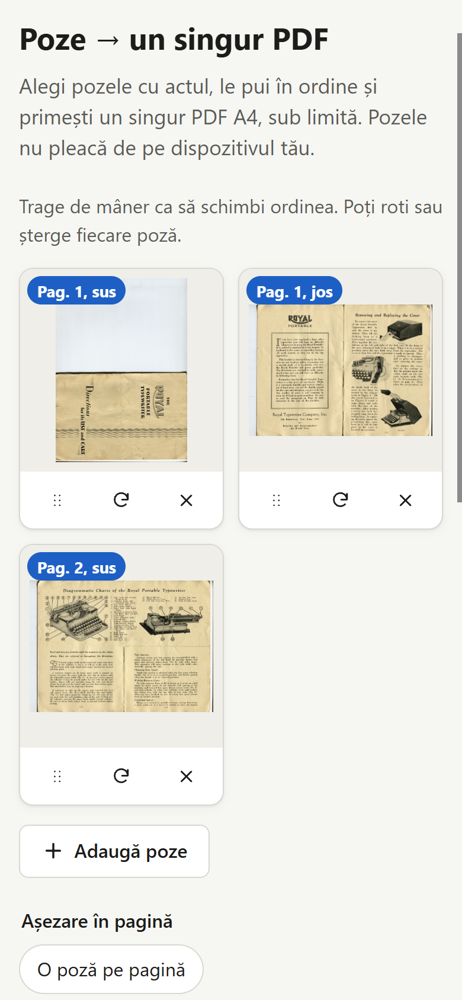
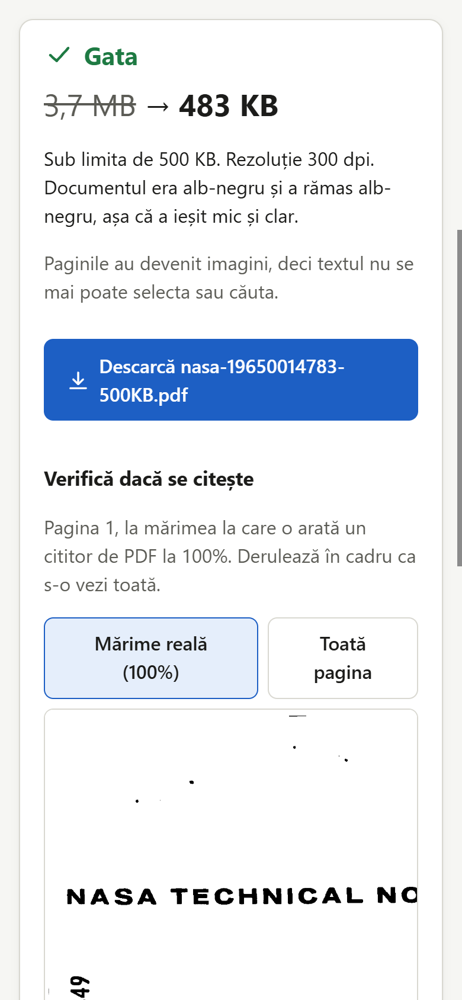

# ActeLocal

Free tools that get scans and phone photos under a portal's upload limit, entirely in the browser. Built for people in Romania uploading documents to SPV, ONRC, university admissions or job applications; the interface is in Romanian.

**Live:** https://actelocal.pages.dev

<p>
  
  
</p>

## What it does

- **Compress PDF** (`/compress-pdf/`): pick a PDF, usually a scan, and a size limit (500 KB to 10 MB, or any size). It finds the highest resolution, then quality, that fits, and shows page 1 at 100% so you can check it still reads well. Black-and-white scans stay black and white, compressed as CCITT G4 (fax) images, which keeps them small and sharp.
- **Photos to PDF** (`/photos-to-pdf/`): phone photos of a document into one A4 PDF under the limit. Reorder (drag, or arrow keys), rotate and delete photos; one photo per page, or two (ID card front and back). Location and other photo metadata don't make it into the PDF.
- **Warnings** before compressing a PDF that has an electronic signature or is an ANAF (XFA) form, since neither survives, and for PDFs made on a computer, which rarely shrink as images.

## Privacy: nothing is uploaded

There is no server. Files are read and processed in the browser and never leave the device. Three ways to check:

1. **Airplane mode:** open a tool, wait a few seconds, then go offline. It keeps working, because the page loads everything it needs up front.
2. **DevTools → Network:** processing a file makes no network requests at all.
3. **The code:** this repository. [`public/_headers`](public/_headers) sets a Content-Security-Policy with `connect-src 'self'`, so the page can't send data to any other site, even through a bug.

[`scripts/ui-test.mjs`](scripts/ui-test.mjs) checks the first two automatically, on every page.

## How it works

Each page is drawn into a canvas (by pdf.js for PDFs), encoded as JPEG or CCITT G4 in Web Workers, and packed into a new PDF with pdf-lib. A search picks the highest resolution, then the highest quality, that fits the limit, by measuring real encoded sizes rather than estimating them. Design, measurements and how each part is verified: [docs/engine-design.md](docs/engine-design.md).

Stack: Vite and TypeScript with no framework, [pdfjs-dist](https://github.com/mozilla/pdf.js) (Apache-2.0) and [pdf-lib](https://github.com/Hopding/pdf-lib) (MIT). A static site on Cloudflare Pages.

## Development

```sh
npm install
npm run dev       # dev server; /dev/engine.html runs the engine on any file
npm test          # unit tests
npm run build     # type-check and build to dist/
npm run preview   # serve dist/ with the production headers from public/_headers
```

Tools, all dev-only and driving the system's Chrome over the DevTools protocol:

| Command | What it does |
|---|---|
| `node scripts/ui-test.mjs` | End-to-end test of the real pages, offline, at phone and desktop size, with screenshots. `BASE=https://actelocal.pages.dev` tests the live site |
| `node scripts/bench.mjs …` | Engine benchmarks, result snapshots, profiling and the CSP check (see the comment at its top) |
| `node scripts/check-g4-tables.mjs` | Compares the CCITT code tables with libtiff's |

Test files go in `test-files/`, which git ignores.

## Deploy

Cloudflare Pages, connected to this repository: every push to `main` deploys. Build command `npm run build`, output directory `dist`.

## License

MIT
